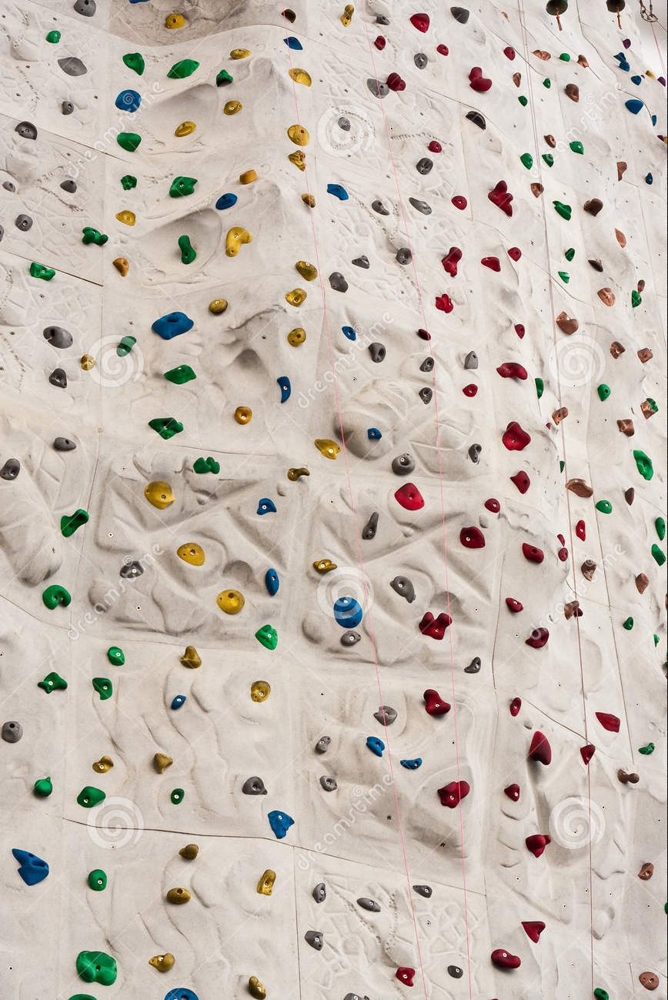
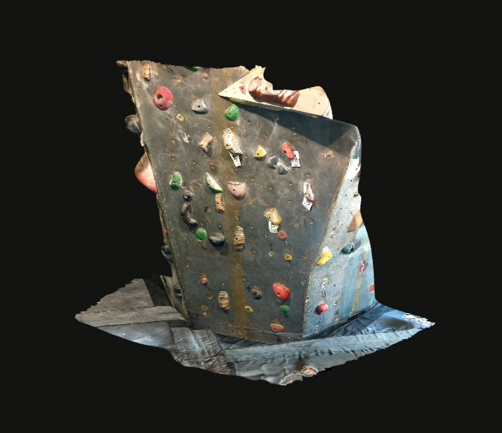
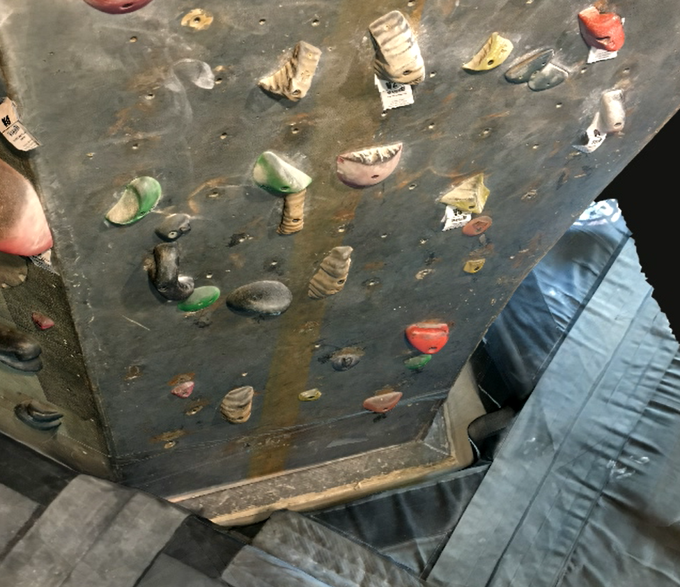
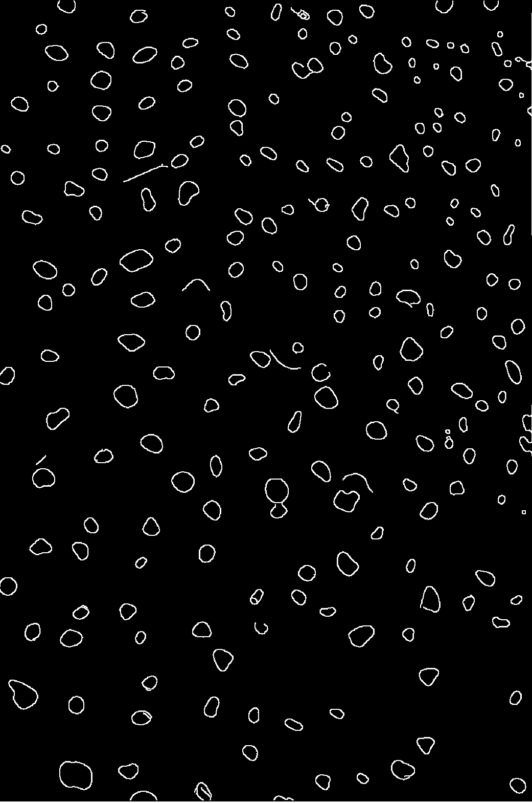
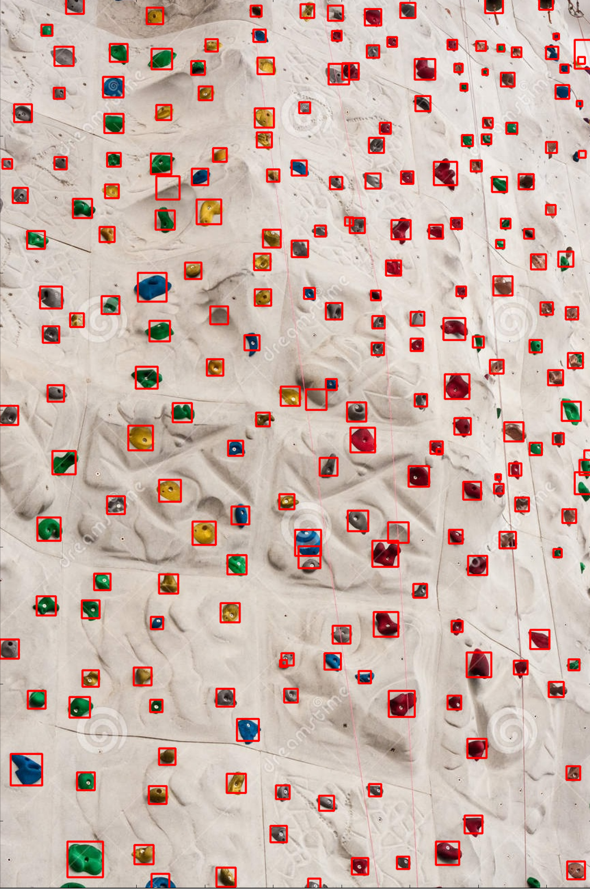
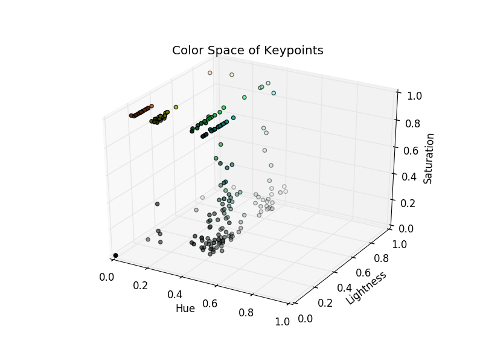
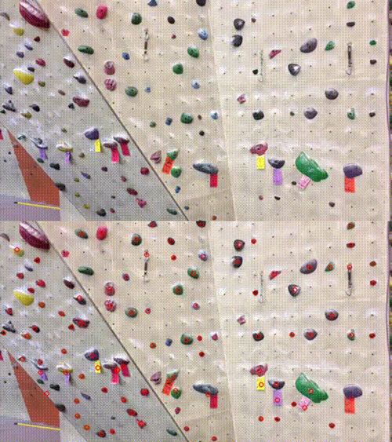
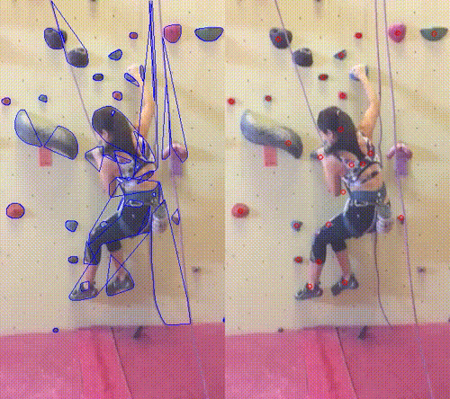

# NeuralClimb

This project is an attempt to create a system that can detect and
classify holds on a rock climbing wall in real time. Current progress
includes hold detection and classification by color with few errors on
2D images of rock climbing walls. The project is currently on pause, however next steps would be to test the use of
the detection and classification algorithm on live video streams.
Preliminary work had begun to classify each hold by *positivity* to
allow for a proper gauge of difficulty. Further work would then begin on
planning routes based on the holds found and their difficulty.

## Acquisition Method

The part of the goal of this project is to be able to detect and
classify holds on a wall in real time while at a climbing gym. For this
reason, a method of capturing the wall in memory is needed. Common
methods of acquiring this data can range from laser scanning to simply
taking pictures. As a low cost solution for acquisition a single camera
can be used and, from that, both two dimensional images and three
dimension models could be generated.

### 2D Space

Two dimensional images are the easiest method of acquisition. A camera
phone is a widely available tool that can be used for this. This method
is excellent for rapid acquisition and can provide a large number of
test sets for the project. It also allows for the use of stock images
online. And example image can be seen in Figure
<a href="#fig:im3" data-reference-type="ref"
data-reference="fig:im3">1</a>.

<figure id="fig:im3" data-latex-placement="ht">

<figcaption>Stock image
of a rock climbing wall.</figcaption>
</figure>

This method, however, suffers from a number of drawbacks, mainly camera
and lighting differences and lack of depth information. There can be a
great deal of variance between an image taken by a camera phone and an
image from a DSLR. If the detection algorithm is created to fit images
taken on one camera, there is risk of overfitting and poor results when
a different camera is used. This method can also suffer from shadows and
variance in lighting conditions. Both of these issues can be minimized
by using a good quality camera in a climbing gym, where lighting
conditions can be considered constant. Depth information can still be an
issue, however. Some amount of depth can be found by taking a sequence
of images, but holes inside holds and the top of holds that are high on
the wall cannot be found.

### 3D Space

Three dimensional information is gained using photogrammetry. This is a
method of creating a 3D model by stitching together 2D images. Autodesk
Remake is used to complete this process. The result is a high resolution
model that fully recreates the wall. An example portion can be seen in
figures <a href="#fig:View1" data-reference-type="ref"
data-reference="fig:View1">2</a> and
<a href="#fig:View2" data-reference-type="ref"
data-reference="fig:View2">3</a>. This model gives full view inside and
around each hold and preserves the angle of the wall relative to the
ground. The example model is created from 250 images of the wall from
several different views.

<figure id="fig:View1" data-latex-placement="ht">

<figcaption>Right
side view of wall model.</figcaption>
</figure>

<figure id="fig:View2" data-latex-placement="ht">

<figcaption>Top side
view of wall model.</figcaption>
</figure>

With this method, the main drawback is acquisition time. The current
model only spans about 5% of the entire wall but required about 250
pictures and nearly an hour of computation time. The pictures can be
taken relatively quickly, about one minute for the full set, but each
set of 250 must be processed into a model individually due to the limit
set by the free version of Autodesk ReMake. These models would then have
to be concatenated together to build the full model.

Space complexity is also a consideration. The model shown has just over
a quarter million points, which could lead to unrealistic processing
times. This can, however, be combated by decimating the model, that is,
reducing the number of polygons used to represent the model. This
experimentally is able to remove up to 80% of the points used, at the
expense of resolution. The full wall, however would still have excess of
a few million data points.

The final drawback of this method, which leads to the decision to
continue in 2D space instead, is that the model itself is not a
real-time model. It captures the wall from some point in time, but as
new routes are set, the model becomes obsolete. Future work could
explore the possibility of mapping new holds to a 3D model of the bare
wall structure, instead of recreating the entire model each time. For
this project however, 2D images will be used.

## Hold Detection

One of the main aspects of this project is the ability to locate the
holds found on a given rock wall. This allows the project to work on any
wall without having prior knowledge of the wall or its holds. This also
accounts for the rapidly changing nature of rock climbing walls. Most
gyms will add new routes to their wall on a weekly basis, making
pre-mapped hold locations obsolete. An ideal hold detector finds the
location and size of all holds within a given image.

### Detection method

The following process is run on a single two dimensional image. The
photo in Figure <a href="#fig:im3" data-reference-type="ref"
data-reference="fig:im3">1</a> will be used for example. First, a median
filter is applied to the starting image. This removes some amount of
noise from chalk and other impurities on the wall while preserving or
even sharpening edges between holds and the wall. Then, openCV’s Canny
Edge detector is applied, resulting in a binary image where only the
edges remain. This detector works by finding the intensity gradient of
the image, applying non-maximum suppression to get thin edges, and then
thresholding the resulting edges between an upper and lower boundary.
The last portion, the threshold, is subject to change in our process due
to difference in lighting conditions and the style of the wall. Instead
of using a fixed threshold, Otsu method is applied beforehand to find an
optimal threshold for the image. The resulting image contains the edges
of each hold with sufficient accuracy. From the edges, the contours of
the image are found. Each contour defines a curve containing a set of
continuous points or, in this case, the edges.

<figure id="fig:im3cont" data-latex-placement="ht">

<figcaption>Contours of processed
image.</figcaption>
</figure>

Due to chalk residue, lighting issues, etc., these contours are
occasionally missing some small portion of the full hold. To account for
these gaps, a minimum spanning polygon, or convex hull, of each contour
is used. From there, openCV’s blob detector can be used to identify each
of these hull. Parameters are set so that blobs that are too small or
have too low inertia are ignored. A list of keypoints are returned with
position and size of each hold. This can be seen in Figure
<a href="#fig:im3keys" data-reference-type="ref"
data-reference="fig:im3keys">5</a>.

<figure id="fig:im3keys" data-latex-placement="t">

<figcaption>Final
results of hold detection.</figcaption>
</figure>

#### Drawbacks

There are some issues seen with this classification method. Shadows can
occasionally be misclassified as holds and holds that have colors very
similar to the wall can missed. This method also has no depth
information, which means it can be hard to distinguish the type of the
hold and therefore the difficulty. Two holds can be drastically
different in complexity if one juts out of the wall and the other is
nearly flush. Using a live video and tracking information about each
hold could provide a valid solution to this issue.

## Color Sorting

From the keypoints generated from the image, the color of each hold is
determined. In most rock climbing gyms, the route on the wall is shown
by colors. A set of yellow colored holds would mark a single route to
the top. Each route has some rating of difficulty (Normally marked
between V0 and V7, where V0 is the easiest). By finding the color of
each hold, it can be associated with a route and some information can be
gained about that difficulty of the hold can be gained.

## Color identification

Because of difference in lighting conditions, color shades between
holds, and chalk or other debris covering holds, color identification
can be difficult. The image is first converted into the HLS colorspace
to more heavily emphasize the difference in hues between routes. Then,
for each keypoint identified by the hold detector, an image mask is
generated. This mask marks a subsection of the image to consider. While
the hold will take up most of this section, there are still portions of
the wall and chalk cover in the image, making a mean color filter
inaccurate. Instead, the pixels of each channel of the image is placed
into a histogram, which shows the number of occurrences of each value.
Each bin of the histogram is set to have a width of 4, meaning values
0-4, 5-8, and so on are grouped together. This effectively quantizes the
image so that slightly difference pixels are not considered different.
The most common color is then returned from the resulting histogram and
the channels recombined. The resulting colors can be seen plotted in HLS
space with its original RGB color in the graph on Figure
<a href="#fig:im3color" data-reference-type="ref"
data-reference="fig:im3color">6</a>.

<figure id="fig:im3color" data-latex-placement="ht">

<figcaption>Plot of the color of each hold in HLS
space. Apparent clusters can be seen, the red group, yellow group,
green, etc. Using k-means clustering algorithm, these groups can be
identified to find which route each hold belongs to.</figcaption>
</figure>

## Live View

From here, we focus on using the algorithm on live video, a kalman filter needs to be implemented in order to track the holds as the camera moves, and information is gathered about each hold over time to classify it by its type and the difficulty of using it. Once a network of holds is finished, the path planning can begin.

<figure id="fig:liveView" data-latex-placement="ht">

<figcaption>Demo of live detection.</figcaption>
</figure>

<figure id="fig:liveViewClimb" data-latex-placement="ht">

<figcaption>Second iteration run, featuring my climbing partner, showing live contours with detection output.</figcaption>
</figure>

## Future Work

As stated above, this work is concluded, however future work may include classifying each hold by positivity to allow for a proper gauge of difficulty. From there, the route planning can begin, based on the holds found and their difficulty.
